[ABOUT](#about-me) · [SKILLS](#technical-skills) · [CS BASICS](#computer-science-fundamentals) · [WORK](#featured-work) · [INTERESTS](#areas-of-interest) · [ROADMAP](#learning-roadmap) · [ACTIVITY](#github-activity)

---

## ABOUT ME

I'm **Rashed Chowdury Palash**, a third-year Computer Science and Engineering (CSE) student who is passionate about becoming a **Data Scientist**. I have completed core CSE courses in algorithms, data structures, OOP, database systems, and computer architecture, and I work in Python, C, C++, and SQL.

Right now I'm learning **data analysis** and **machine learning** through the CodeWithHarry Data Science course, practicing Python by building mini projects, and exploring web development with **Django**.

> **LEARN BY DOING.** Understand the concept, practice it in code, and build something with it.

---

## TECHNICAL SKILLS

| Category | Technologies |
|:---|:---|
| **Programming Languages** | Python, C, C++, SQL |
| **Web Development** | HTML, CSS, Django (learning) |
| **Tools** | Git, GitHub |
| **Currently learning** | Data Analysis, Machine Learning |

Technologies reflect my current experience and ongoing learning, not claimed professional proficiency levels.

---

## COMPUTER SCIENCE FUNDAMENTALS

Core CSE subjects I have completed:

| Subject | Focus |
|:---|:---|
| **Algorithms** | Designing and analyzing efficient solutions |
| **Data Structures** | Organizing and managing data effectively |
| **Object-Oriented Programming** | Building structured, reusable code |
| **Database Management Systems** | Designing, storing, and querying data |
| **Computer Organization & Architecture** | How computers work at the hardware level |

---

## FEATURED WORK

<table width="100%">
<tr>
<td width="50%" valign="top">

**PYTHON MINI PROJECTS**

### [MINI PROJECTS ↗](https://github.com/Rashed3325?tab=repositories)

Small projects I build to practice Python fundamentals and strengthen my problem-solving.

**Focus:** Python · Practice · Implementation

</td>
<td width="50%" valign="top">

**DATA ANALYSIS & ML**

### [DATA SCIENCE JOURNEY ↗](https://github.com/Rashed3325?tab=repositories)

Practice and notes from my data analysis and machine learning learning journey.

**Focus:** Data Analysis · Machine Learning · Python

</td>
</tr>
<tr>
<td width="50%" valign="top">

**WEB DEVELOPMENT**

### [DJANGO PROJECTS ↗](https://github.com/Rashed3325?tab=repositories)

Learning backend web development by building projects with Django.

**Focus:** Django · Python · Web Apps

</td>
<td width="50%" valign="top">

**GITHUB PROFILE**

### [EXPLORE MY WORK ↗](https://github.com/Rashed3325?tab=repositories)

Browse my repositories to follow my learning, practice, and projects.

[Browse All Repositories](https://github.com/Rashed3325?tab=repositories)

</td>
</tr>
</table>

Repository cover images are illustrative artwork, not actual application screenshots.

---

## AREAS OF INTEREST

| Area | Focus |
|:---|:---|
| **Data Science** | Turning data into insight and useful decisions |
| **Databases & SQL** | Storing, querying, and managing data |
| **Data Analysis** | Cleaning, exploring, and visualizing data |
| **Machine Learning** | Understanding models and how to train and evaluate them |
| **Web Development** | Building web applications with Django |
| **Python Projects** | Strengthening fundamentals through hands-on mini projects |

---

## LEARNING ROADMAP

`Python Fundamentals` → `Data Analysis` → `Machine Learning` → `Django Web Apps` → `Deep Learning` → `Real-World Projects`

My goal is to build the skills needed to work with real data: analyze it, model it, and present the results through useful projects.

This roadmap represents ongoing learning goals, not a claim that every stage has been completed.

---

## GITHUB ACTIVITY

Statistics are provided by third-party services and may be cached, rate-limited, or temporarily unavailable. Language distribution reflects repository code composition, not individual proficiency. Private contributions may not appear.

---

## LET'S CONNECT

Open to connecting with learners and developers interested in data science, Python, and web development.

**RASHED CHOWDURY PALASH · 2026**

